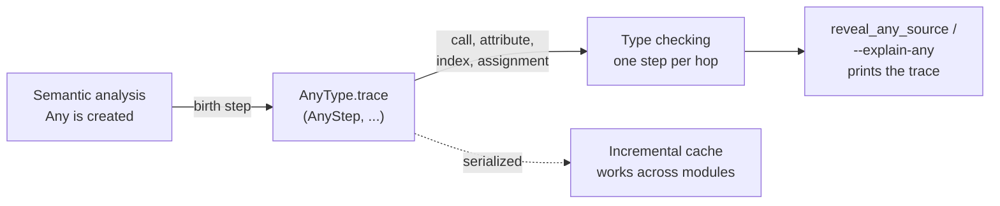

# mypy-why-any

An extension of [mypy](https://github.com/python/mypy) that answers one question:
**why does this expression have type `Any`?**

> Seeing that a value has type `Any` does not necessarily reveal where an annotation is
> missing. The source of the problem may be several calls or modules away.
> Extend mypy so that users can ask why an expression has type `Any`.

## Before and after

```python
import json

config = json.loads('{"port": 8080}')
port = config["port"]
```

Stock mypy:

```
reveal_type(port)
note: Revealed type is "Any"
```

The output gives the type and nothing about where it came from.

With this extension:

```
reveal_any_source(port)
note: Any comes from explicit 'Any' in return type of "loads" (typeshed/stdlib/json/__init__.pyi:78)
note:   -> returned by "json.loads(...)" (line 3)
note:   -> assigned to "config" (line 3)
note:   -> indexing an Any value ("config[...]") (line 4)
note:   -> assigned to "port" (line 4)
```

The first line shows where the `Any` was born. Every following line is one step it took to
reach the expression.

## Quick start

```bash
git clone git@github.com:REPIRK/mypy-why-any.git
cd mypy-why-any
python -m venv .venv
.venv/Scripts/python -m pip install -e .        # Linux/macOS: .venv/bin/python
.venv/Scripts/python -m mypy examples/01_explicit_any.py
```

## Two ways to ask

| Tool | When to use |
|---|---|
| `reveal_any_source(expr)` | Point at one expression. No import needed, works like `reveal_type`. If the type only *contains* `Any` (e.g. `list[Any]`), each `Any` inside is explained. |
| `--explain-any` | Get the same trace automatically under `--warn-return-any` and `--disallow-any-expr` errors, and under `reveal_type()` of an `Any` value. |

```
$ mypy --warn-return-any --explain-any examples/05_explain_any_flag.py
error: Returning Any from function declared to return "int"  [no-any-return]
note: Any comes from explicit 'Any' in return type of "loads" (typeshed/stdlib/json/__init__.pyi:78)
note:   -> returned by "json.loads(...)" (line 9)
note:   -> assigned to "settings" (line 9)
note:   -> indexing an Any value ("settings[...]") (line 10)
note:   -> indexing an Any value ("settings[...][...]") (line 10)
```

## Where an `Any` can come from

| Origin | Message |
|---|---|
| Explicit `Any` in an annotation or stub | `explicit 'Any' in return type of "f"` |
| Parameter without annotation | `missing annotation for parameter "x" of "f"` |
| Function without return annotation | `missing return annotation of "f"` |
| Generic class without parameters (`list`, `dict`) | `missing type parameters for "dict"` |
| Module mypy cannot find or does not follow | `import of "lib", which mypy could not follow or find` |

Steps along the way: a call returned it, an `Any` was called, an attribute or item was
taken from it, an operator was applied, it was assigned to a variable or attribute.

## Examples

Each file in [`examples/`](examples) shows one origin. Run any of them with
`.venv/Scripts/python -m mypy <file>`.

| File | What it shows | Flags |
|---|---|---|
| [`01_explicit_any.py`](examples/01_explicit_any.py) | `Any` from a library stub | |
| [`02_missing_annotation.py`](examples/02_missing_annotation.py) | Unannotated function, through an attribute | |
| [`03_unfollowed_import.py`](examples/03_unfollowed_import.py) | Missing third-party module | `--ignore-missing-imports` |
| [`04_omitted_generics.py`](examples/04_omitted_generics.py) | Bare `dict` hides `Any` inside the type | |
| [`05_explain_any_flag.py`](examples/05_explain_any_flag.py) | Trace under an error | `--warn-return-any --explain-any` |
| [`cross_module/`](examples/cross_module) | `Any` born in one module, revealed in another | run in that folder: `mypy main.py service.py storage.py --warn-return-any --explain-any` |

## How it works



1. **The trace.** Every `AnyType` has a `trace`: a tuple of `AnyStep(message, module, line)`.
   The first step is the birth, the rest is the path. An `Any` derived from another `Any`
   continues the trace of its source.
   — [`mypy/types.py`](mypy/types.py): `AnyStep`, `AnyType.trace`, `AnyType.with_step`
2. **Birth.** Recorded when mypy analyzes annotations and function signatures, so the message
   can name the parameter or return type it belongs to.
   — [`mypy/semanal.py`](mypy/semanal.py): `anal_type`, `analyze_func_def`, `add_unknown_imported_symbol`;
   [`mypy/typeops.py`](mypy/typeops.py): `callable_type` for fully unannotated functions
3. **Steps.** Added while type checking, for every expression whose type is `Any`.
   — [`mypy/checkexpr.py`](mypy/checkexpr.py): `record_any_step`;
   [`mypy/checker.py`](mypy/checker.py): `set_inferred_type` for assignments
4. **Output.** `reveal_any_source` is a new kind of `RevealExpr`; `--explain-any` adds notes
   to existing errors. — [`mypy/messages.py`](mypy/messages.py): `reveal_any_source`, `explain_any`
5. **Cross-module.** The trace is part of the type, so it is written to the incremental
   cache together with it. A second run reads the same trace back.

All the logic lives in one new file, [`mypy/anytrace.py`](mypy/anytrace.py). Changes to the
rest of mypy are small hooks.

## Tests

```bash
.venv/Scripts/python -m pip install -r test-requirements.txt
.venv/Scripts/python -m pytest -q -n 0 mypy/test/testcheck.py -k explain-any
```

Feature tests are in [`test-data/unit/check-explain-any.test`](test-data/unit/check-explain-any.test),
including aliases, reassignment, ignored errors, and cross-module incremental checks with
both cache formats. Run the core regression suites with:

```bash
.venv/Scripts/python -m pytest -q -n 4 mypy/test/testcheck.py mypy/test/testsemanal.py mypy/test/testtypes.py
```

## Limitations

- Reading a variable is not a separate step. The trace shows the assignment, not each use.
- At control-flow joins, the trace shows one possible source of `Any`.
- In unchecked function bodies, expressions have `Any` regardless of their runtime value.
  Use `--check-untyped-defs` or annotate the function to trace their inferred types.
- `Any` from a type error or from special forms is described by its kind; the exact place is
  not recorded when it is created deep inside type checking.
- The trace keeps at most 25 steps. The birth step is always kept, the oldest intermediate
  steps are dropped first.
- Not yet tested in a mypyc-compiled build; no performance measurements yet.

## Based on mypy

This repository is a fork of [python/mypy](https://github.com/python/mypy). The original
README is in [`README.mypy.md`](README.mypy.md), the documentation for the new features is in
[`docs/source/command_line.rst`](docs/source/command_line.rst) (`--explain-any`) and
[`docs/source/common_issues.rst`](docs/source/common_issues.rst) (`reveal_any_source`).
